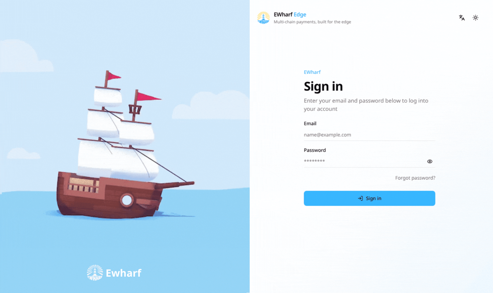
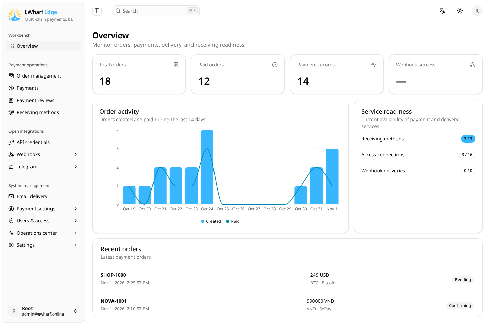
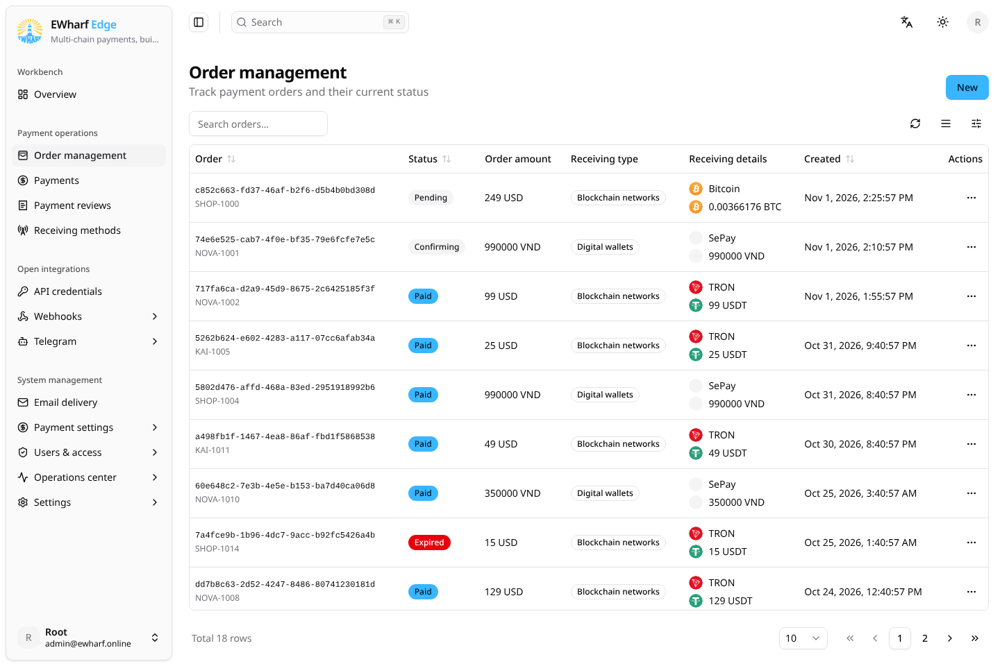
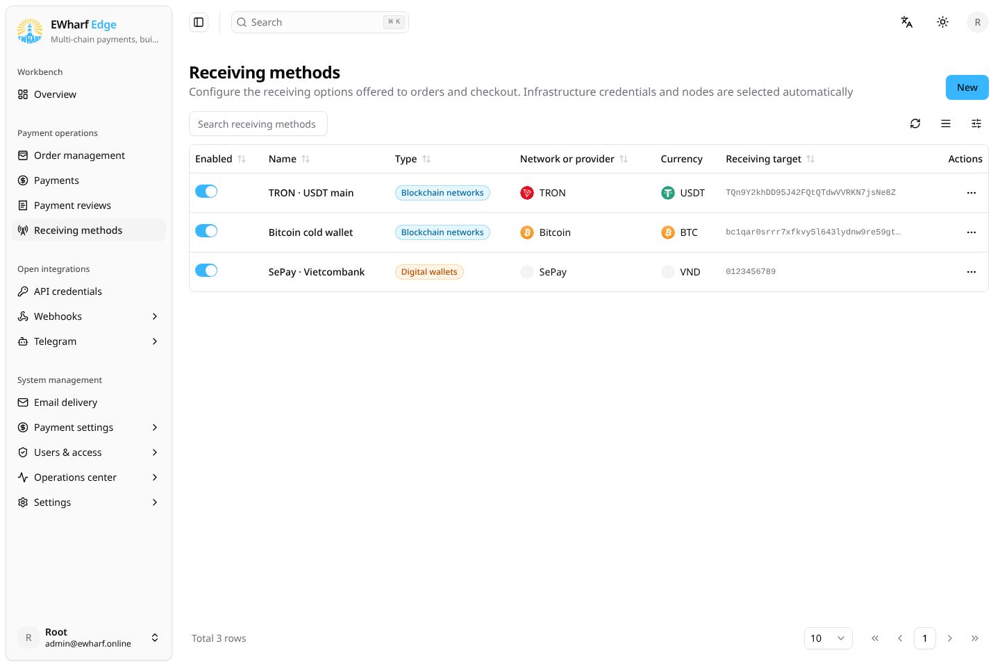
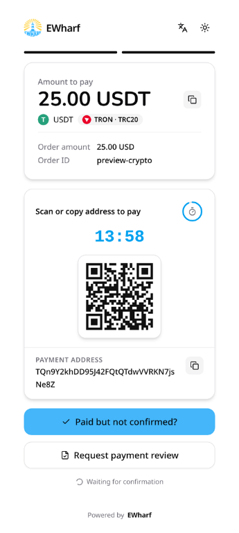
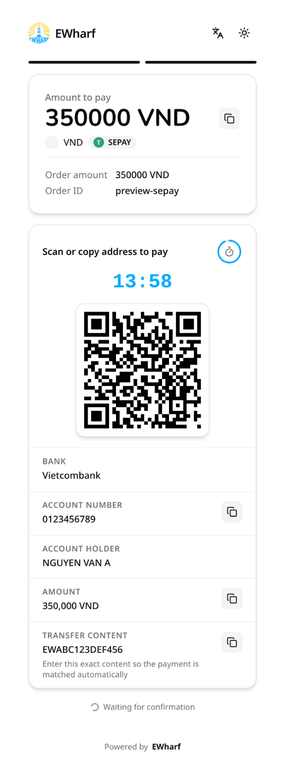
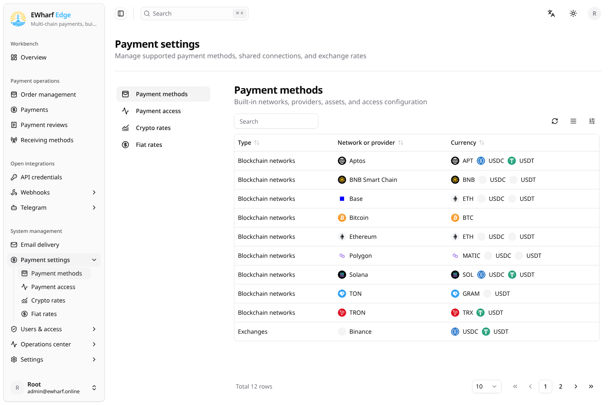
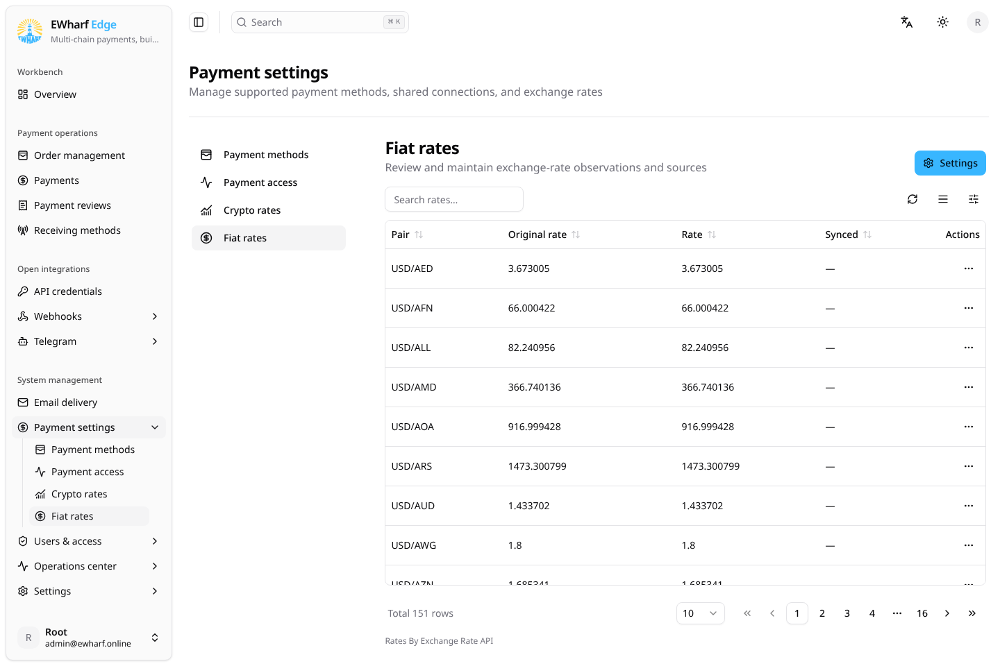
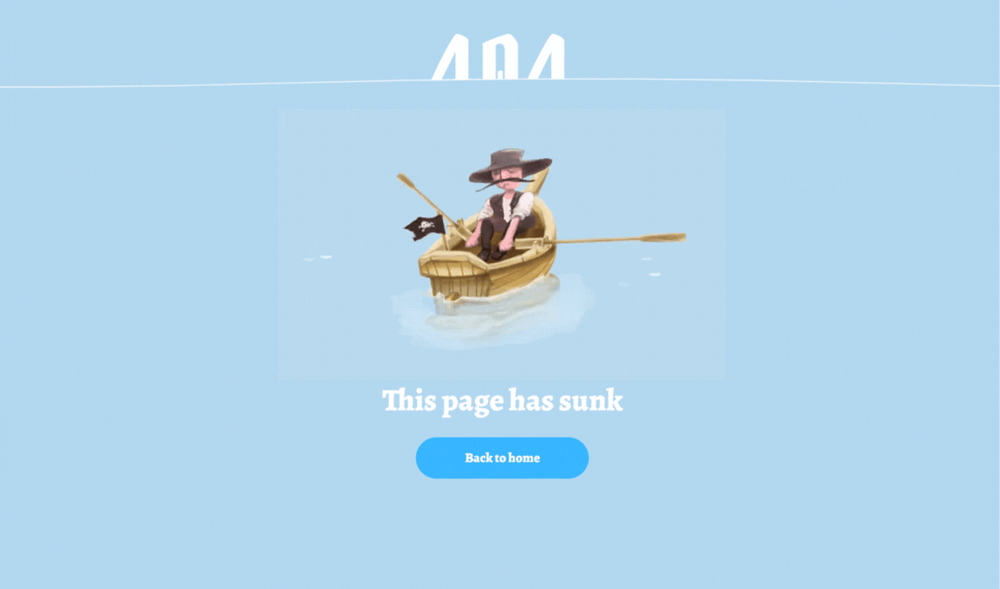
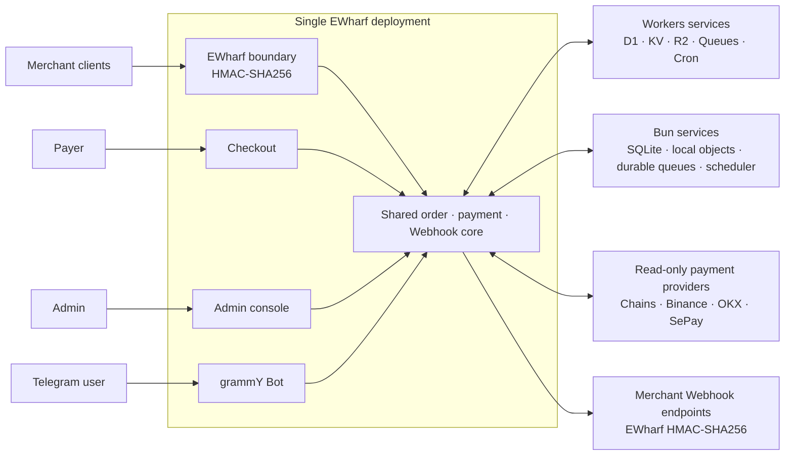

# EWharf

**Multi-chain payments, built for the edge.**


EWharf is a self-hosted, single-tenant cryptocurrency payment gateway for
Cloudflare Workers or a Bun/Nitro Docker container. One deployment provides
signed merchant APIs, a responsive checkout, payment operations, dynamic
role-based access control, durable Webhook delivery, scheduled processing, and
Telegram automation.

It is designed for operators who want to retain control of their payment
infrastructure while using read-only chain, exchange, and wallet integrations.
Merchants are external API clients; operators and administrators work through
the protected `/admin` application.

> [!IMPORTANT]
> EWharf is under active development. A built-in integration means the
> capability is implemented; it does not mean that the method is automatically
> production-ready or exposed at checkout. Production use requires
> deployer-owned endpoints or read-only credentials, configured receiving
> methods, backups, monitoring, and real-platform acceptance tests.

## Core capabilities

## Screenshots

<p align="center">
  
  
</p>
<p align="center">
  
  
</p>
<p align="center">
  
  
</p>
<p align="center">
  
  
</p>
<p align="center">
  
</p>

- Receive payments through TRON, EVM networks, TON, Aptos, Solana, and Bitcoin.
- Detect inbound payments through read-only Binance, OKX, and SePay (Vietnamese bank transfer) adapters.
- Expose the signed EWharf merchant protocol with JSON and form input.
- Preserve immutable payment snapshots and process order state transitions and
  payment accounting centrally and idempotently.
- Deliver merchant callbacks through a durable Queue-backed outbox with retry
  history, manual retry, and audit records.
- Protect administration with Better Auth, optional TOTP, and dynamic multi-role RBAC,
  including a protected built-in `root` role.
- Run payment scanning, expiry, cleanup, connection health, and rate sync through
  durable queues and scheduled jobs on either supported runtime.
- Operate Telegram Bots through grammY with Inline orders, public commands, and
  unified private, group, and channel notification subscriptions.
- Provide a responsive React 19 admin console, checkout, public status pages,
  OpenAPI reference, and seven UI locales (English, Japanese, Korean, Russian,
  Traditional and Simplified Chinese, and Vietnamese).

## Supported payment integrations

| Type | Integration | Built-in assets |
| --- | --- | --- |
| On-chain | TRON / TRC20 | USDT, TRX |
| On-chain | Ethereum / ERC20 | USDT, USDC, ETH |
| On-chain | Base | USDT, USDC, ETH |
| On-chain | BNB Smart Chain / BEP20 | USDT, USDC, BNB |
| On-chain | Polygon | USDT, USDC, MATIC |
| On-chain | TON | USDT, GRAM |
| On-chain | Aptos | USDT, USDC |
| On-chain | Solana | USDT, USDC |
| On-chain | Bitcoin | BTC |
| Exchange | Binance | USDT, USDC |
| Exchange | OKX | USDT, USDC |
| Bank transfer | SePay | VND |

* Note: One wallet can appear in several forms: the same wallet can be written as EQ… (bounceable), UQ… (non-bounceable), or in raw form 0:abc…. These three forms look different but are the same wallet.
EWharf currently accepts only EQ… or UQ… (the full 48 characters) and does not accept the raw 0:… form. Testnet wallets use the same EQ/UQ format, so you cannot tell them apart by eye. Entering a testnet wallet in a production deployment means losing money.
Use UQ… to receive payments. A receiving wallet is only an address for receiving, not a contract, so the non-bounceable form is safer.
USDT is a Jetton: funds do not go straight to your main wallet address but to your own separate Jetton wallet. So you must check against the correct USDT Jetton master address stored in the asset.
Needs real verification, not yet confirmed: the code currently compares addresses as identical strings (destination === address). If TON Center returns an address in a different form from the one you entered (for example 0:…, or EQ instead of UQ), the system may miss a transaction even though the funds have arrived. I have not called the real API, so I could not confirm this. When you enable TON, send a small test payment first to check that the order is recorded.

Payment methods form the built-in capability catalog. Checkout exposure is
controlled separately by ready receiving methods. A receiving method must have
the required public connection or read-only account configuration and pass its
availability checks before it can be offered to a payer.

See [Payment methods and receiving methods](docs/en-US/PAYMENT_METHODS.md) for
provider requirements, limits, retry behavior, and the production checklist.

## Architecture



One Worker or Bun container owns every product surface and the shared order and
payment core.
EWharf HMAC-SHA256 terminates at an explicit protocol boundary, then uses the
order service, state machine, checkout, and Webhook pipeline. Each
runtime keeps its database authoritative, uses its own cache and private object
adapter, and moves scans and Webhook retries outside synchronous requests.
Payment adapters remain read-only.

## Deploy to Cloudflare Workers

EWharf deploys as one Cloudflare Worker with D1, KV, private R2, two Queues,
and Cron Triggers. Complete the [deployment checklist](docs/en-US/DEPLOYMENT.md)
before accepting production payments.

### Deploy button

[](https://deploy.workers.cloudflare.com/?url=https://github.com/ewharf/ewharf)

The guided flow requires a public source repository. It provisions the bindings
declared in `wrangler.jsonc`, applies D1 migrations, and builds the Worker. Keep
the auto-detected `bun run build` Build command and `bun run deploy` Deploy
command. Workers Builds reuses the generated artifact instead of rebuilding it
during deployment. When deployment finishes, open `/install` on the Worker URL
to initialize the instance.

### Wrangler CLI

Authenticate Wrangler and run the package deployment command:

```bash
bun install
bunx wrangler login
bun run deploy
```

If D1 must be prepared manually, run `bunx wrangler d1 create ewharf`
followed by `bun run db:migrate:remote`. Do not commit the generated database ID.

The `predeploy` hook reuses the exact named D1, KV, R2, and Queue resources when
they already exist and creates only missing resources. It applies the D1
baseline and injects resolved D1/KV IDs into the generated deployment artifact
before publication; account-specific IDs are never written to `wrangler.jsonc`.

The deployment declares these bindings:

| Binding | Cloudflare product | Purpose |
| --- | --- | --- |
| `DB` | D1 | Authoritative application, payment, authorization, and delivery data |
| `CACHE` | KV | Short-lived validated caches and ancillary telemetry |
| `FILES` | R2 | Private payment-review evidence and generated exports |
| `PAYMENT_QUEUE` | Queues | Asynchronous payment scanning |
| `WEBHOOK_QUEUE` | Queues | Asynchronous merchant Webhook delivery |

The existing Workers workflow is unchanged: `bun run build`, `bun run predeploy`,
and `bun run deploy` continue to use the Cloudflare Vite adapter. The Bun build
is separate and does not alter Workers output.

## Deploy with Bun and Docker

The public [GHCR package](https://github.com/orgs/ewharf/packages/container/package/ewharf)
supports `linux/amd64` and `linux/arm64`. It is public, so no registry login is
required.

Choose the image tag that fits your deployment:

| Tag | Use |
| --- | --- |
| `latest` | Recommended stable release |
| `alpha` | Latest prerelease for testing |
| `1.0.0` | A fixed release that will not change unexpectedly |

### Docker Compose (recommended)

Save the following as `compose.yml`:

```yaml
services:
  ewharf:
    image: ghcr.io/ewharf/ewharf:latest
    restart: unless-stopped
    ports:
      - "3000:3000"
    environment:
      EWHARF_DATA_DIR: /var/lib/ewharf
    volumes:
      - ewharf-data:/var/lib/ewharf

volumes:
  ewharf-data:
```

```bash
docker compose pull
docker compose up -d
```

To test a prerelease, change `latest` to `alpha` in the `image` line before
starting the service.

### Docker command

If you do not use Compose, run the same service directly:

```bash
docker volume create ewharf-data
docker run --detach --name ewharf --restart unless-stopped \
  --publish 3000:3000 \
  --env EWHARF_DATA_DIR=/var/lib/ewharf \
  --volume ewharf-data:/var/lib/ewharf \
  ghcr.io/ewharf/ewharf:latest
```

Open `http://your-host:3000/install` after the container starts. Confirm the
public address and Allowed Hosts, then create the first root user. Application,
security, and email settings are managed in the admin interface; they do not
need additional container environment variables.

The named volume stores the database, uploaded files, queue state, and all other
runtime data. Keep it when updating or recreating the container. Check the
service with `curl --fail http://127.0.0.1:3000/healthz`; view Compose logs with
`docker compose logs --follow ewharf`. Update with:

```bash
docker compose pull
docker compose up -d
```

See the [deployment guide](docs/en-US/DEPLOYMENT.md) for production checks and
[Bun data operations](docs/en-US/NODE_DATA_OPERATIONS.md) for backup, restore,
and Cloudflare migration.

## Releases and container images

Updates to `alpha` are prereleased by semantic-release as `1.0.0-alpha.1`,
`alpha.2`, and so on using Conventional Commits. Alpha containers receive the
exact version and moving `alpha` tags only. After testing, merge into `main` to
publish stable `1.0.0`; stable containers also receive major, minor, and
`latest` tags. Each release updates `package.json` and `bun.lock`, creates a
GitHub Release with generated notes and a tag, then calls the independent Docker
smoke and multi-architecture GHCR workflow. Native x64 and Arm64 runners build
and smoke-test in parallel before publishing the combined manifest. After a
stable publish, matching alpha GitHub prereleases, Git tags, and GHCR image
versions are removed automatically.

The GHCR package is public, so release and prerelease images support
unauthenticated pulls.

## Keep a fork synchronized

Forks include the `Sync upstream` GitHub Actions workflow. It runs every day at
00:00 and 12:00 UTC and can also be started manually from **Actions → Sync
upstream → Run workflow**. The workflow discovers the fork's parent repository
and merges the upstream default branch into the fork's default branch using
GitHub's fork sync API.

After creating a fork, open its **Actions** tab and enable workflows; GitHub
disables workflows in a new fork until its owner opts in. The workflow requests
only `contents: write` access from the repository `GITHUB_TOKEN` and does not
require a personal access token. It never force-pushes or overwrites fork-only
commits. A merge conflict fails the run and must be resolved manually before
automatic synchronization can continue.

## Quick start

### Requirements

- [Bun](https://bun.sh/) 1.3 or later
- A local environment supported by [Wrangler](https://developers.cloudflare.com/workers/wrangler/)

Install dependencies and start the development server:

```bash
bun install
bun run dev
```

`bun run dev` applies pending migrations to the local `ewharf` D1 database
and starts the application at <http://localhost:3000>. Local development uses
Wrangler-managed local bindings; it does not apply migrations to remote D1.

Open <http://localhost:3000/install> on the first run. Installation creates the
first user, the protected `root` role, runtime secrets, payment defaults, four
public Telegram commands with six-locale message content, and Telegram defaults.
The detected Origin must be confirmed and is stored as the application URL and
an Allowed Host, then the new root user is signed in automatically. Installation
does not create a Telegram Bot or call Telegram.

Password recovery is available from the sign-in page. Configure and order one or
more providers under the top-level **Admin → Email delivery** page. Both
runtimes show the same provider types and ordered fallback behavior.

After installation:

1. Review the generated system settings in `/admin`.
2. Confirm the detected HTTPS origin and back up the runtime configuration.
3. Configure and test the required public connections or read-only credentials.
4. Create receiving methods for the assets that should appear at checkout.
5. Create a scoped merchant API credential and complete a signed test order.

## Merchant integration

EWharf is the merchant protocol, built on the order service, idempotency rules,
state machine, checkout, query behavior, and callback pipeline.

### Create an order

```text
POST /payments/ewharf/v1/order/create-transaction
```

The endpoint accepts JSON or form data. A request includes the numeric credential
`pid` and a lowercase HMAC-SHA256 signature over the sorted, non-empty
parameters, using the credential Secret as the HMAC key. Supplying an existing
`order_id` never creates a second order. Omitting both `token` and `network`
creates a selectable order; EWharf does not silently default it to TRON.

### Query an order

```text
GET /payments/ewharf/v1/order/query
```

Provide exactly one `trade_id` or `order_id` and sign the request with the same
credential. A credential can query only orders it created.

### Receive callbacks

The merchant supplies `notify_url` when creating an order. Callback destinations
must pass the instance SSRF and security policy. Committed order events are
delivered asynchronously with deterministic signatures, retained attempts,
bounded retries, and an audited manual retry path. Handlers should verify the
signature, process duplicate events idempotently, and acknowledge only after
committing their local state.

Use the runtime `/docs` page or the tracked
[OpenAPI contract](public/openapi.yaml) for the authoritative fields and status
values. Signing vectors, callback parameters, and error codes are
documented in the [Merchant API guide](docs/en-US/MERCHANT_API.md).

## Technology stack

| Area | Technology |
| --- | --- |
| Runtime | Cloudflare Workers or Bun/Nitro Docker |
| Application | React 19, TanStack Start/Router/Query/Table/Form |
| UI | Tailwind CSS 4, shadcn/Radix |
| Authentication | Better Auth |
| Authorization | Project-owned dynamic RBAC with permission bit masks |
| Data | Cloudflare D1 or SQLite, Drizzle ORM |
| Runtime services | KV/R2/Queues/Cron or local cache/objects/durable queues/scheduler |
| Telegram | grammY, Telegram Bot API |
| Internationalization | ParaglideJS |
| Tooling | Bun, strict TypeScript, Vitest, Biome, Wrangler |

## Development and quality

Common development commands:

```bash
bun run dev
bun run db:migrate:local
bun run generate-routes
bun run typecheck
bun run test
bun run check
bun run build
bun run build:bun
```

Run `bun run hooks:install` once per clone to enable the local Lefthook
Conventional Commit check. Its commitlint policy is declared in `package.json`.

Use `bun run db:generate` only for an intentional Drizzle schema change and
review the generated migration. Run `bun run generate-paraglide` before checks
that import generated messages without starting Vite. `src/paraglide` is
ignored and does not need to be committed.

Before submitting a completed change, run the final quality gate on the same
working tree:

```bash
bun run typecheck
bun run test
bun run check
bun run build
bun run build:bun
```

Tests are organized under `tests/unit`, `tests/integration`, `tests/security`,
and `tests/e2e`. Deterministic fixtures prove application behavior, but retained
live-provider suites are intentionally skipped and must be run manually with
deployer-owned infrastructure during production acceptance.

## Documentation

| Topic | Documentation |
| --- | --- |
| Deployment and production sign-off | [Deployment checklist](docs/en-US/DEPLOYMENT.md) |
| Bun backup, restore, and Cloudflare import | [Bun data operations](docs/en-US/NODE_DATA_OPERATIONS.md) |
| Merchant requests, signatures, and errors | [Merchant API](docs/en-US/MERCHANT_API.md) |
| Provider configuration and receiving methods | [Payment methods](docs/en-US/PAYMENT_METHODS.md) |
| Inbound endpoints and merchant delivery | [Webhooks](docs/en-US/WEBHOOKS.md) |
| Bots, Inline orders, commands, and subscriptions | [Telegram](docs/en-US/TELEGRAM.md) |
| Authentication, secrets, uploads, and response policy | [Security notes](docs/en-US/SECURITY.md) |
| Machine-readable API contract | [OpenAPI YAML](public/openapi.yaml) |
| Vietnamese documentation (same topics) | [docs/vi-VN](docs/vi-VN/) |
| Runtime API reference | `/docs` on a running instance |

## Security

- Never commit `.dev.vars`, Bot tokens, API Secrets, private keys, seed phrases,
  exchange secrets, or Cloudflare credentials.
- EWharf never stores withdrawal authority, wallet private keys, or seed
  phrases. Exchange and wallet integrations must use the minimum read-only
  permissions required for payment detection.
- API credential Secrets, receiving-method credentials, and Telegram Bot tokens
  are encrypted before storage with their configured application encryption
  keys. They are revealed only at creation or rotation and resolved server-side
  when required.
- Runtime settings are stored in the authoritative database. Runtime secret values are returned only to
  administrators with `settings:read`, rendered in password fields, and
  preserved when an update submits an empty value.
- Better Auth owns passwords, sessions, and optional TOTP. Configure Allowed
  Hosts, HTTPS, Origin and CSRF validation, rate limits, and email password
  recovery before production use. When TOTP is enabled, acknowledge and retain
  its recovery codes.
- Back up D1 or the complete Bun data directory before upgrades. Replacing
  `runtime.better_auth_secret` invalidates existing authentication material.
- Callback destinations, provider responses, uploads, Queue messages, and KV
  values are untrusted boundaries. Production acceptance must include SSRF,
  signature, permission-path, retry, duplicate-event, and recovery checks.

Read the [security notes](docs/en-US/SECURITY.md) and the security sections of
the deployment checklist before exposing an instance publicly.

## Acknowledgements and license

Protocol and internal data model are not copied into EWharf unless
explicitly documented as a boundary adapter.

EWharf is licensed under [GPL-3.0-or-later](LICENSE).

Copyright (C) 2026 EWharf. EWharf is a personal project and brand of Pahm. See [NOTICE](NOTICE) for details.
