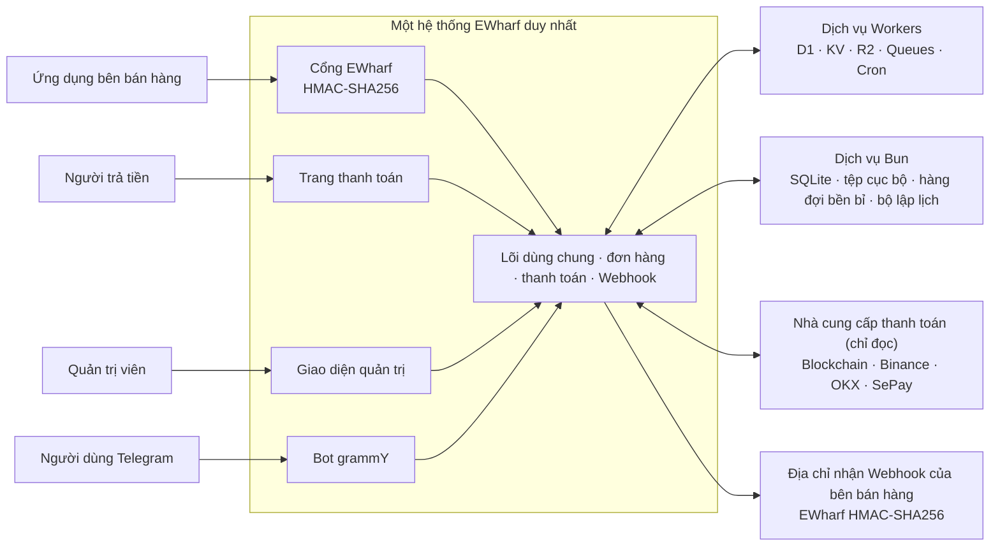

# EWharf

[English](README.md) · Tiếng Việt

**Thanh toán đa chuỗi (multi-chain), xây dựng cho môi trường edge.**

EWharf là cổng thanh toán tiền mã hóa do bạn tự vận hành, dành riêng cho một
đơn vị sử dụng (mỗi hệ thống chỉ phục vụ một chủ). EWharf chạy được trên
Cloudflare Workers hoặc trong một container Docker dùng Bun/Nitro. Chỉ với một
lần triển khai, bạn có đủ: API bán hàng có ký xác thực, trang thanh toán dùng
được trên mọi màn hình, công cụ quản lý thanh toán, phân quyền linh hoạt theo
vai trò, hệ thống gửi Webhook (thông báo tự động gửi về hệ thống của bạn) bền
bỉ, các tác vụ chạy theo lịch, và tự động hóa qua Telegram.

EWharf dành cho những ai muốn tự nắm quyền kiểm soát hạ tầng thanh toán của
mình, và chỉ cần dùng các kết nối **chỉ đọc** tới blockchain, sàn giao dịch và
ví. Bên bán hàng (merchant) là các ứng dụng bên ngoài gọi vào API; người vận
hành và quản trị viên làm việc trong ứng dụng `/admin` có bảo vệ.

> [!IMPORTANT]
> EWharf đang trong giai đoạn phát triển tích cực. "Đã tích hợp sẵn" chỉ có
> nghĩa là tính năng đã được viết xong, **không** có nghĩa là phương thức đó tự
> động sẵn sàng cho môi trường thật hay tự động hiện ra ở trang thanh toán. Để
> dùng thật, bạn cần có địa chỉ kết nối (endpoint) hoặc thông tin đăng nhập chỉ
> đọc của riêng bạn, đã cấu hình phương thức nhận tiền, có sao lưu, có giám sát,
> và đã chạy thử nghiệm nghiệm thu trên nền tảng thật.

## Những gì EWharf làm được

- Nhận thanh toán qua TRON, các mạng EVM, TON, Aptos, Solana và Bitcoin.
- Phát hiện tiền vào thông qua các bộ kết nối chỉ đọc của Binance, OKX và SePay
  (chuyển khoản ngân hàng Việt Nam).
- Cung cấp giao thức bán hàng EWharf có ký xác thực, nhận dữ liệu dạng JSON
  hoặc form.
- Lưu lại ảnh chụp thanh toán không thể sửa đổi; việc chuyển trạng thái đơn hàng
  và hạch toán tiền được xử lý tập trung, và nếu bị gửi lặp lại cũng chỉ được
  tính một lần.
- Gửi thông báo (callback) cho bên bán hàng qua hàng đợi bền bỉ, có lưu lịch sử
  thử lại, cho phép thử lại thủ công và có ghi nhật ký kiểm tra.
- Bảo vệ khu vực quản trị bằng Better Auth, có thể bật thêm mã TOTP (mã xác thực
  hai bước), và phân quyền nhiều vai trò linh hoạt, trong đó vai trò `root` có
  sẵn được bảo vệ đặc biệt.
- Quét thanh toán, xử lý hết hạn, dọn dẹp, kiểm tra tình trạng kết nối và đồng
  bộ tỷ giá, tất cả chạy qua hàng đợi và tác vụ theo lịch trên cả hai môi
  trường chạy được hỗ trợ.
- Vận hành Bot Telegram bằng grammY, có đơn hàng Inline, các lệnh công khai, và
  đăng ký nhận thông báo thống nhất cho chat riêng, nhóm và kênh.
- Có giao diện quản trị, trang thanh toán, trang trạng thái công khai và tài
  liệu OpenAPI viết bằng React 19, hỗ trợ bảy ngôn ngữ giao diện (tiếng Anh,
  Nhật, Hàn, Nga, Trung phồn thể, Trung giản thể và tiếng Việt).

## Các hình thức thanh toán được hỗ trợ

| Loại | Tích hợp | Tài sản có sẵn |
| --- | --- | --- |
| Trên blockchain | TRON / TRC20 | USDT, TRX |
| Trên blockchain | Ethereum / ERC20 | USDT, USDC, ETH |
| Trên blockchain | Base | USDT, USDC, ETH |
| Trên blockchain | BNB Smart Chain / BEP20 | USDT, USDC, BNB |
| Trên blockchain | Polygon | USDT, USDC, MATIC |
| Trên blockchain | TON | USDT, GRAM |
| Trên blockchain | Aptos | USDT, USDC |
| Trên blockchain | Solana | USDT, USDC |
| Trên blockchain | Bitcoin | BTC |
| Sàn giao dịch | Binance | USDT, USDC |
| Sàn giao dịch | OKX | USDT, USDC |
| Chuyển khoản ngân hàng | SePay | VND |

* Note: Một ví có nhiều dạng: cùng một ví có thể viết là EQ… (bounceable), UQ… (non-bounceable) hoặc dạng thô 0:abc…. Ba dạng này khác chữ nhưng là cùng một ví.
EWharf hiện chỉ nhận EQ… hoặc UQ… (đủ 48 ký tự), không nhận dạng thô 0:…. Ví testnet cũng cùng dạng EQ/UQ nên nhìn bằng mắt không phân biệt được. Nhập nhầm ví testnet vào bản chạy thật là mất tiền.
Nên dùng UQ… để nhận tiền. Ví nhận chỉ là địa chỉ để nhận, không phải hợp đồng nên dạng non-bounceable an toàn hơn.
USDT là Jetton: tiền không vào thẳng địa chỉ ví chính mà vào ví Jetton riêng của bạn. Vì vậy phải đối chiếu đúng địa chỉ Jetton master của USDT lưu trong asset.
Cần kiểm tra thật, chưa chắc chắn: code đang so sánh địa chỉ bằng chuỗi giống hệt (destination === address). Nếu TON Center trả về địa chỉ ở dạng khác với dạng bạn nhập (ví dụ 0:… hay EQ thay vì UQ), hệ thống có thể bỏ sót giao dịch dù tiền đã về. Mình chưa gọi thử API thật nên chưa xác nhận được. Khi bật TON, bạn nên chuyển thử một khoản nhỏ để xem đơn có được ghi nhận không.
"Phương thức thanh toán" là danh sách những gì EWharf hỗ trợ sẵn. Còn việc phương
thức nào thực sự hiện ra ở trang thanh toán thì do các "phương thức nhận tiền"
đã sẵn sàng quyết định. Một phương thức nhận tiền phải có đủ thông tin kết nối
công khai hoặc tài khoản chỉ đọc, và vượt qua các bước kiểm tra, thì mới được
đưa ra cho người trả tiền chọn.

Xem [Phương thức thanh toán và phương thức nhận tiền](docs/vi-VN/PAYMENT_METHODS.md)
để biết yêu cầu của từng nhà cung cấp, các giới hạn, cách thử lại và danh sách
kiểm tra trước khi chạy thật.

## Kiến trúc



Một Worker hoặc một container Bun đảm nhiệm toàn bộ các phần của sản phẩm, cùng
với lõi xử lý đơn hàng và thanh toán dùng chung.
Chữ ký HMAC-SHA256 của EWharf được kiểm tra ngay tại một "cổng" riêng; sau đó
yêu cầu mới đi vào dịch vụ đơn hàng, bộ máy chuyển trạng thái, trang thanh toán
và quy trình gửi Webhook. Mỗi môi trường chạy lấy cơ sở dữ liệu của mình làm
nguồn dữ liệu chính, dùng bộ nhớ đệm và nơi lưu tệp riêng, và đưa việc quét
thanh toán cũng như gửi lại Webhook ra ngoài luồng xử lý trực tiếp của yêu cầu.
Các bộ kết nối thanh toán luôn ở chế độ chỉ đọc.

## Triển khai lên Cloudflare Workers

EWharf được triển khai thành một Cloudflare Worker duy nhất, đi cùng D1, KV, R2
riêng tư, hai hàng đợi (Queues) và các lịch chạy (Cron Triggers). Hãy làm xong
[danh sách kiểm tra triển khai](docs/vi-VN/DEPLOYMENT.md) trước khi nhận thanh
toán thật.

### Nút triển khai nhanh

[](https://deploy.workers.cloudflare.com/?url=https://github.com/ewharf/ewharf)

Quy trình có hướng dẫn này yêu cầu kho mã nguồn công khai. Nó sẽ tạo các tài
nguyên được khai báo trong `wrangler.jsonc`, áp dụng các bản cập nhật cơ sở dữ
liệu D1 và build Worker. Hãy giữ nguyên lệnh Build `bun run build` và lệnh Deploy
`bun run deploy` mà hệ thống tự nhận. Workers Builds sẽ dùng lại kết quả đã
build thay vì build lại khi triển khai. Khi xong, mở `/install` trên địa chỉ của
Worker để khởi tạo hệ thống.

### Dùng dòng lệnh Wrangler

Đăng nhập Wrangler rồi chạy lệnh triển khai của dự án:

```bash
bun install
bunx wrangler login
bun run deploy
```

Nếu bạn phải tự chuẩn bị D1 bằng tay, hãy chạy `bunx wrangler d1 create ewharf`
rồi `bun run db:migrate:remote`. Đừng đưa mã ID của cơ sở dữ liệu vừa tạo vào
kho mã nguồn.

Bước `predeploy` sẽ dùng lại đúng các tài nguyên D1, KV, R2 và Queue đã có cùng
tên, và chỉ tạo những tài nguyên còn thiếu. Nó cũng áp dụng cấu trúc cơ sở dữ
liệu ban đầu của D1 và điền mã ID của D1/KV vào bản triển khai được tạo ra trước
khi phát hành; các mã ID riêng của tài khoản không bao giờ bị ghi vào
`wrangler.jsonc`.

Bản triển khai khai báo các kết nối (binding) sau:

| Binding | Sản phẩm Cloudflare | Dùng để làm gì |
| --- | --- | --- |
| `DB` | D1 | Dữ liệu chính của ứng dụng: thanh toán, phân quyền, gửi thông báo |
| `CACHE` | KV | Bộ nhớ đệm ngắn hạn đã được kiểm tra, và số liệu phụ |
| `FILES` | R2 | Chứng cứ duyệt thanh toán (riêng tư) và các tệp xuất ra |
| `PAYMENT_QUEUE` | Queues | Quét thanh toán chạy nền |
| `WEBHOOK_QUEUE` | Queues | Gửi Webhook cho bên bán hàng chạy nền |

Cách làm việc với Workers hiện tại không đổi: `bun run build`,
`bun run predeploy` và `bun run deploy` vẫn dùng bộ chuyển đổi Cloudflare Vite.
Bản build cho Bun là một quy trình riêng và không làm thay đổi kết quả cho
Workers.

## Triển khai bằng Bun và Docker

[Gói GHCR](https://github.com/orgs/ewharf/packages/container/package/ewharf) công
khai hỗ trợ `linux/amd64` và `linux/arm64`. Vì là gói công khai nên bạn không cần
đăng nhập vào kho chứa để tải về.

Hãy chọn phiên bản (tag) của image phù hợp với nhu cầu:

| Tag | Dùng khi |
| --- | --- |
| `latest` | Bản ổn định, nên dùng |
| `alpha` | Bản thử nghiệm mới nhất, để kiểm thử |
| `1.0.0` | Một bản cố định, sẽ không tự thay đổi bất ngờ |

### Docker Compose (khuyên dùng)

Lưu nội dung sau thành tệp `compose.yml`:

```yaml
services:
  ewharf:
    image: ghcr.io/ewharf/ewharf:latest
    restart: unless-stopped
    ports:
      - "3000:3000"
    environment:
      EWHARF_DATA_DIR: /var/lib/ewharf
    volumes:
      - ewharf-data:/var/lib/ewharf

volumes:
  ewharf-data:
```

```bash
docker compose pull
docker compose up -d
```

Muốn thử bản thử nghiệm, hãy đổi `latest` thành `alpha` ở dòng `image` trước khi
khởi động.

### Dùng lệnh Docker

Nếu không dùng Compose, bạn có thể chạy trực tiếp cùng dịch vụ đó:

```bash
docker volume create ewharf-data
docker run --detach --name ewharf --restart unless-stopped \
  --publish 3000:3000 \
  --env EWHARF_DATA_DIR=/var/lib/ewharf \
  --volume ewharf-data:/var/lib/ewharf \
  ghcr.io/ewharf/ewharf:latest
```

Sau khi container chạy, hãy mở `http://your-host:3000/install`. Xác nhận địa chỉ
công khai và Allowed Hosts (danh sách tên miền được phép truy cập), rồi tạo tài
khoản root đầu tiên. Các cài đặt về ứng dụng, bảo mật và email đều được quản lý
ngay trong giao diện quản trị; bạn không cần thêm biến môi trường nào cho
container.

Ổ lưu trữ (volume) có tên này chứa cơ sở dữ liệu, các tệp tải lên, trạng thái
hàng đợi và mọi dữ liệu chạy khác. Hãy giữ lại nó khi cập nhật hoặc tạo lại
container. Kiểm tra dịch vụ bằng
`curl --fail http://127.0.0.1:3000/healthz`; xem nhật ký của Compose bằng
`docker compose logs --follow ewharf`. Cập nhật bằng:

```bash
docker compose pull
docker compose up -d
```

Xem [hướng dẫn triển khai](docs/vi-VN/DEPLOYMENT.md) để biết các bước kiểm tra
trước khi chạy thật, và [Bun data operations](docs/vi-VN/NODE_DATA_OPERATIONS.md)
để biết cách sao lưu, khôi phục và chuyển dữ liệu sang Cloudflare.

## Phát hành và image container

Mỗi lần cập nhật nhánh `alpha`, semantic-release sẽ tự phát hành bản thử nghiệm
như `1.0.0-alpha.1`, `alpha.2`, v.v. dựa trên quy ước viết commit Conventional
Commits. Container alpha chỉ nhận tag phiên bản chính xác và tag `alpha` luôn trỏ
về bản mới nhất. Sau khi kiểm thử xong, hãy gộp (merge) vào `main` để phát hành
bản ổn định `1.0.0`; container ổn định còn nhận thêm các tag major, minor và
`latest`. Mỗi lần phát hành sẽ cập nhật `package.json` và `bun.lock`, tạo một
GitHub Release có ghi chú tự sinh cùng một tag, rồi gọi quy trình Docker độc lập
để chạy thử nhanh và đưa image đa kiến trúc lên GHCR. Các máy chạy x64 và Arm64
thật sẽ build và chạy thử song song trước khi công bố bản gộp. Sau khi bản ổn
định được phát hành, các bản alpha tương ứng trên GitHub, các tag Git và các
phiên bản image trên GHCR sẽ được tự động xóa.

Gói GHCR là công khai, nên cả bản phát hành lẫn bản thử nghiệm đều tải về được mà
không cần đăng nhập.

## Giữ bản fork luôn được cập nhật

Các bản fork có sẵn quy trình GitHub Actions tên `Sync upstream`. Quy trình này
chạy mỗi ngày lúc 00:00 và 12:00 (giờ UTC), và cũng có thể chạy tay từ
**Actions → Sync upstream → Run workflow**. Nó tự tìm kho gốc của bản fork rồi
gộp nhánh mặc định của kho gốc vào nhánh mặc định của bản fork, bằng chức năng
đồng bộ fork của GitHub.

Sau khi tạo fork, hãy mở tab **Actions** và bật các quy trình, vì GitHub tắt
chúng trong fork mới cho đến khi chủ sở hữu đồng ý bật. Quy trình này chỉ xin
quyền `contents: write` từ `GITHUB_TOKEN` của kho, và không cần token cá nhân. Nó
không bao giờ ghi đè cưỡng bức và không xóa các commit chỉ có ở fork. Nếu bị
xung đột khi gộp, lần chạy sẽ báo lỗi và bạn phải tự xử lý xung đột thì việc đồng
bộ tự động mới tiếp tục được.

## Bắt đầu nhanh

### Yêu cầu

- [Bun](https://bun.sh/) phiên bản 1.3 trở lên
- Một môi trường máy cục bộ được [Wrangler](https://developers.cloudflare.com/workers/wrangler/)
  hỗ trợ

Cài các thư viện cần thiết và khởi động máy chủ phát triển:

```bash
bun install
bun run dev
```

Lệnh `bun run dev` sẽ áp dụng các bản cập nhật cơ sở dữ liệu còn thiếu cho D1
cục bộ tên `ewharf`, rồi chạy ứng dụng tại <http://localhost:3000>. Khi phát
triển trên máy, hệ thống dùng các kết nối cục bộ do Wrangler quản lý; nó không
áp dụng bản cập nhật cho D1 trên Cloudflare.

Lần chạy đầu tiên, hãy mở <http://localhost:3000/install>. Bước cài đặt sẽ tạo
người dùng đầu tiên, vai trò `root` được bảo vệ, các khóa bí mật cho hệ thống,
các thiết lập thanh toán mặc định, bốn lệnh Telegram công khai kèm nội dung ở
sáu ngôn ngữ, và các thiết lập Telegram mặc định. Bạn cần xác nhận địa chỉ gốc
(Origin) mà hệ thống phát hiện được; địa chỉ này sẽ được lưu làm địa chỉ ứng
dụng và làm một Allowed Host, sau đó người dùng root mới được tự động đăng nhập.
Bước cài đặt không tạo Bot Telegram và không gọi tới Telegram.

Trang đăng nhập có sẵn chức năng khôi phục mật khẩu. Hãy cấu hình và sắp xếp thứ
tự một hoặc nhiều nhà cung cấp email tại mục **Admin → Email delivery** (cấp cao
nhất). Cả hai môi trường chạy đều hiển thị cùng các loại nhà cung cấp và cùng
cách chuyển sang nhà cung cấp dự phòng theo thứ tự.

Sau khi cài đặt xong:

1. Xem lại các thiết lập hệ thống đã được tạo tại `/admin`.
2. Xác nhận địa chỉ HTTPS được phát hiện và sao lưu cấu hình đang chạy.
3. Cấu hình và kiểm tra các kết nối công khai hoặc thông tin đăng nhập chỉ đọc
   cần thiết.
4. Tạo các phương thức nhận tiền cho những tài sản bạn muốn hiện ở trang thanh
   toán.
5. Tạo một thông tin xác thực API cho bên bán hàng (có giới hạn quyền) và hoàn
   thành một đơn thử có ký xác thực.

## Tích hợp cho bên bán hàng

EWharf là giao thức dành cho bên bán hàng, xây dựng trên dịch vụ đơn hàng, quy
tắc chống xử lý trùng, bộ máy chuyển trạng thái, trang thanh toán, cách tra cứu
và quy trình gửi callback.

### Tạo đơn hàng

```text
POST /payments/ewharf/v1/order/create-transaction
```

Điểm kết nối này nhận dữ liệu JSON hoặc form. Một yêu cầu gồm `pid` (mã số của
thông tin xác thực) và một chữ ký HMAC-SHA256 viết thường, tính trên các tham số
không rỗng đã được sắp xếp, dùng Secret của thông tin xác thực làm khóa HMAC.
Nếu gửi lại một `order_id` đã có thì hệ thống không bao giờ tạo thêm đơn thứ hai.
Nếu bỏ trống cả `token` và `network`, đơn hàng sẽ cho phép người trả tiền tự
chọn; EWharf không âm thầm mặc định sang TRON.

### Tra cứu đơn hàng

```text
GET /payments/ewharf/v1/order/query
```

Hãy cung cấp đúng một trong hai: `trade_id` hoặc `order_id`, và ký yêu cầu bằng
cùng thông tin xác thực. Mỗi thông tin xác thực chỉ tra cứu được những đơn hàng
do chính nó tạo ra.

### Nhận callback

Bên bán hàng cung cấp `notify_url` khi tạo đơn. Địa chỉ nhận callback phải vượt
qua chính sách bảo mật và chính sách chống SSRF (lừa máy chủ truy cập địa chỉ nội
bộ) của hệ thống. Các sự kiện đơn hàng đã được ghi nhận sẽ được gửi đi ở chế độ
nền, với chữ ký xác định trước, có lưu lại từng lần thử, số lần thử lại có giới
hạn, và có cách thử lại thủ công được ghi nhật ký. Phía nhận nên kiểm tra chữ ký,
xử lý các sự kiện trùng lặp sao cho không bị tính hai lần, và chỉ xác nhận đã
nhận sau khi đã lưu xong trạng thái của mình.

Hãy xem trang `/docs` trên hệ thống đang chạy, hoặc
[hợp đồng OpenAPI](public/openapi.yaml) đi kèm mã nguồn, để biết chính xác các
trường và giá trị trạng thái. Mẫu ký, tham số callback và mã lỗi được ghi trong
[hướng dẫn Merchant API](docs/vi-VN/MERCHANT_API.md).

## Công nghệ sử dụng

| Lĩnh vực | Công nghệ |
| --- | --- |
| Môi trường chạy | Cloudflare Workers hoặc Bun/Nitro Docker |
| Ứng dụng | React 19, TanStack Start/Router/Query/Table/Form |
| Giao diện | Tailwind CSS 4, shadcn/Radix |
| Đăng nhập | Better Auth |
| Phân quyền | Phân quyền theo vai trò do dự án tự xây, dùng mặt nạ bit cho quyền |
| Dữ liệu | Cloudflare D1 hoặc SQLite, Drizzle ORM |
| Dịch vụ chạy | KV/R2/Queues/Cron hoặc bộ nhớ đệm/tệp cục bộ/hàng đợi bền bỉ/bộ lập lịch |
| Telegram | grammY, Telegram Bot API |
| Đa ngôn ngữ | ParaglideJS |
| Công cụ | Bun, TypeScript chặt chẽ, Vitest, Biome, Wrangler |

## Phát triển và kiểm soát chất lượng

Các lệnh phát triển thường dùng:

```bash
bun run dev
bun run db:migrate:local
bun run generate-routes
bun run typecheck
bun run test
bun run check
bun run build
bun run build:bun
```

Hãy chạy `bun run hooks:install` một lần cho mỗi bản clone để bật bước kiểm tra
commit theo chuẩn Conventional Commit của Lefthook. Quy tắc commitlint được khai
báo trong `package.json`.

Chỉ dùng `bun run db:generate` khi bạn cố ý thay đổi cấu trúc dữ liệu Drizzle, và
nhớ xem lại bản cập nhật được sinh ra. Hãy chạy `bun run generate-paraglide`
trước các bước kiểm tra có dùng thông điệp đã sinh mà không khởi động Vite.
Thư mục `src/paraglide` bị bỏ qua khi commit nên không cần đưa lên.

Trước khi gửi một thay đổi đã hoàn thành, hãy chạy lượt kiểm tra cuối cùng trên
cùng một bản mã nguồn:

```bash
bun run typecheck
bun run test
bun run check
bun run build
bun run build:bun
```

Các bài kiểm thử được chia thành `tests/unit`, `tests/integration`,
`tests/security` và `tests/e2e`. Các bộ dữ liệu mẫu cố định chứng minh ứng dụng
hoạt động đúng, nhưng các bộ kiểm thử với nhà cung cấp thật được cố ý bỏ qua và
phải tự chạy tay, với hạ tầng của chính bạn, trong lúc nghiệm thu để chạy thật.

## Tài liệu

| Chủ đề | Tài liệu |
| --- | --- |
| Triển khai và nghiệm thu để chạy thật | [Danh sách kiểm tra triển khai](docs/vi-VN/DEPLOYMENT.md) |
| Sao lưu, khôi phục Bun và nhập sang Cloudflare | [Bun data operations](docs/vi-VN/NODE_DATA_OPERATIONS.md) |
| Yêu cầu, chữ ký và mã lỗi cho bên bán hàng | [Merchant API](docs/vi-VN/MERCHANT_API.md) |
| Cấu hình nhà cung cấp và phương thức nhận tiền | [Phương thức thanh toán](docs/vi-VN/PAYMENT_METHODS.md) |
| Điểm nhận tin vào và gửi thông báo cho bên bán hàng | [Webhooks](docs/vi-VN/WEBHOOKS.md) |
| Bot, đơn hàng Inline, các lệnh và đăng ký nhận tin | [Telegram](docs/vi-VN/TELEGRAM.md) |
| Đăng nhập, khóa bí mật, tệp tải lên và chính sách phản hồi | [Ghi chú bảo mật](docs/vi-VN/SECURITY.md) |
| Hợp đồng API đọc được bằng máy | [OpenAPI YAML](public/openapi.yaml) |
| Tài liệu bản tiếng Anh | [docs/en-US](docs/en-US/) |
| Tài liệu API khi hệ thống đang chạy | `/docs` trên hệ thống đang chạy |

## Bảo mật

- Tuyệt đối không đưa `.dev.vars`, token của Bot, Secret của API, khóa riêng tư,
  cụm từ khôi phục ví (seed phrase), khóa bí mật của sàn giao dịch hay thông tin
  đăng nhập Cloudflare vào kho mã nguồn.
- EWharf không bao giờ lưu quyền rút tiền, khóa riêng tư của ví hay cụm từ khôi
  phục ví. Các kết nối với sàn và ví chỉ nên dùng quyền chỉ đọc ở mức tối thiểu
  đủ để phát hiện thanh toán.
- Secret của thông tin xác thực API, thông tin xác thực của phương thức nhận tiền
  và token của Bot Telegram đều được mã hóa trước khi lưu, bằng các khóa mã hóa
  đã cấu hình cho ứng dụng. Chúng chỉ được hiện ra lúc tạo mới hoặc lúc đổi, và
  được giải mã ở phía máy chủ khi cần dùng.
- Các thiết lập khi chạy được lưu trong cơ sở dữ liệu chính. Giá trị bí mật chỉ
  trả về cho quản trị viên có quyền `settings:read`, được hiển thị trong ô mật
  khẩu, và được giữ nguyên nếu lúc cập nhật bạn để trống ô đó.
- Better Auth quản lý mật khẩu, phiên đăng nhập và TOTP (nếu bật). Hãy cấu hình
  Allowed Hosts, HTTPS, kiểm tra Origin và CSRF, giới hạn số lần gọi, và khôi
  phục mật khẩu qua email trước khi chạy thật. Khi bật TOTP, hãy ghi nhận và cất
  giữ cẩn thận các mã khôi phục của nó.
- Hãy sao lưu D1 hoặc toàn bộ thư mục dữ liệu Bun trước khi nâng cấp. Nếu thay
  `runtime.better_auth_secret`, toàn bộ thông tin đăng nhập hiện có sẽ mất hiệu
  lực.
- Địa chỉ nhận callback, phản hồi từ nhà cung cấp, tệp tải lên, tin nhắn trong
  hàng đợi và giá trị trong KV đều là những chỗ không đáng tin. Khi nghiệm thu để
  chạy thật, bạn phải kiểm tra SSRF, chữ ký, đường dẫn phân quyền, thử lại, sự
  kiện trùng lặp và khả năng khôi phục.

Hãy đọc [ghi chú bảo mật](docs/vi-VN/SECURITY.md) và các phần về bảo mật trong
danh sách kiểm tra triển khai trước khi mở hệ thống ra công khai.

## Ghi nhận và giấy phép

Giao thức và mô hình dữ liệu bên trong không được sao chép vào EWharf, trừ khi
được ghi rõ là một bộ chuyển đổi ở ranh giới.

EWharf được cấp phép theo [GPL-3.0-or-later](LICENSE).

Bản quyền (C) 2026 EWharf. EWharf là dự án cá nhân và thương hiệu của Pahm. Xem thêm tại [NOTICE](NOTICE).